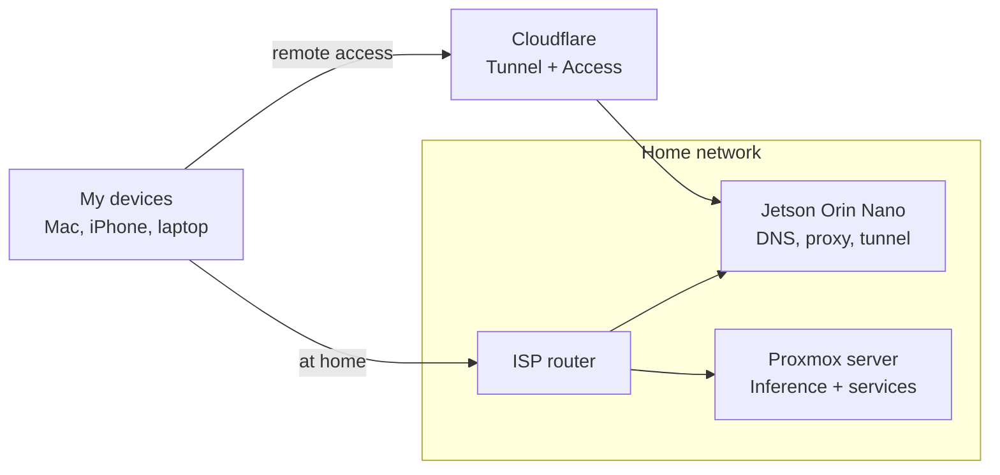

# Private Local AI Infrastructure

A self-hosted AI system that answers questions from technical documents, cites its sources, and keeps all data on hardware I control.

Built and run by Charlie, Noisefloor HQ.

## Why

- **Private:** documents and questions never leave my network.
- **Useful:** every answer comes with sources, so it can be checked.
- **Cost-controlled:** models run on local GPUs, not paid per-call APIs.

## The system at a glance

Two machines. A small Nvidia Jetson Orin Nano is the always-on front door. A Proxmox server runs all inference and every service, one container per service.

## What's inside

| Layer | What it does | Doc |
| --- | --- | --- |
| Network and services | Tunnel, proxy, DNS, one container per service | [architecture](docs/architecture.md) |
| AI pipeline | Document ingest, retrieval, reranking, chat | [ai-pipeline](docs/ai-pipeline.md) |
| Model management | Two GPUs, models loaded and unloaded on demand | [ai-pipeline](docs/ai-pipeline.md#gpu-and-model-management-planned) |
| Security | Access control, TLS, encrypted DNS, admin hardening | [security](docs/security.md) |
| Lessons learned | What broke and how I fixed it | [lessons-learned](docs/lessons-learned.md) |
| Scaling | What I would change to run this for a team | [scaling-to-a-team](docs/scaling-to-a-team.md) |

## Stack

- **Hardware:** Proxmox server with an RTX 4080 and an RTX 4070 Ti; Nvidia Jetson Orin Nano
- **Platform:** Proxmox (LXC containers), Docker
- **Inference:** llama.cpp, with llama-swap planned for model management
- **Models:** gpt-oss-20b (chat), embeddinggemma-2 (embeddings), Qwen3-Reranker-4B (reranking), qwen2.5:3b (small tasks)
- **Application:** Open WebUI, Docling, SearXNG
- **Data:** PostgreSQL with pgvector
- **Network and security:** Cloudflare Tunnel and Access, Nginx Proxy Manager, AdGuard Home, Let's Encrypt

## Status

- The pipeline ran end to end on an earlier build. I am consolidating all inference into one Docker container on Proxmox.
- GPU and model management with llama-swap is a planned design, not yet deployed.
- Next: ingest AV manuals and spec sheets.

## A note on this repo

Everything here is sanitized. Addresses, domain names, and secrets are removed or replaced with placeholders.
