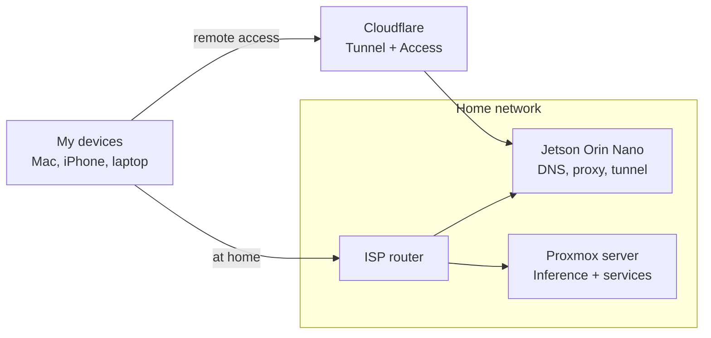
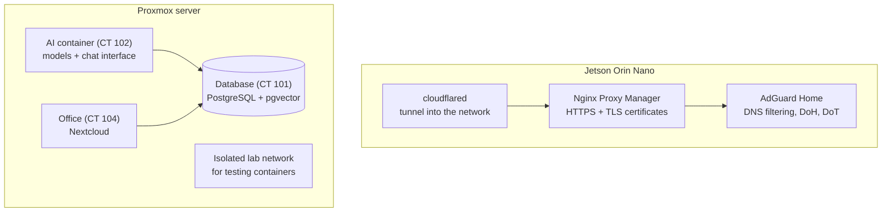

# Architecture

I track the system at four levels. This page covers the first two.

## Level 1: The big picture

Two machines sit behind one router. The Jetson is the always-on front door. The Proxmox server runs inference and every service.

Remote access goes through a Cloudflare tunnel with Cloudflare Access in front of it. No inbound ports are open.

## Level 2: The services

### Two separate paths

- **Web services:** tunnel, then Nginx Proxy Manager, then the service.
- **DNS:** devices at home use AdGuard Home through the router. Remote devices use encrypted DNS over HTTPS through the tunnel.

### Service map

| Service | Runs on | Purpose |
| --- | --- | --- |
| cloudflared | Jetson | Carries the tunnel into the network |
| Nginx Proxy Manager | Jetson | HTTPS and TLS certificates |
| AdGuard Home | Jetson | DNS filtering, DoH, DoT |
| AI container (CT 102) | Proxmox | Models and chat interface |
| Database (CT 101) | Proxmox | PostgreSQL with pgvector, shared by services |
| Office (CT 104) | Proxmox | Nextcloud; ONLYOFFICE planned |
| Lab network | Proxmox | Isolated network for testing new containers |

### Design choices

- **One container per service.** Services stay isolated and easy to rebuild.
- **One shared database container.** Services use it instead of bundling their own.
- **Small always-on edge device.** The Jetson handles access and DNS, so the big server can be rebooted freely.
