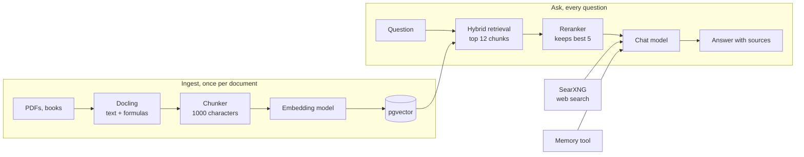
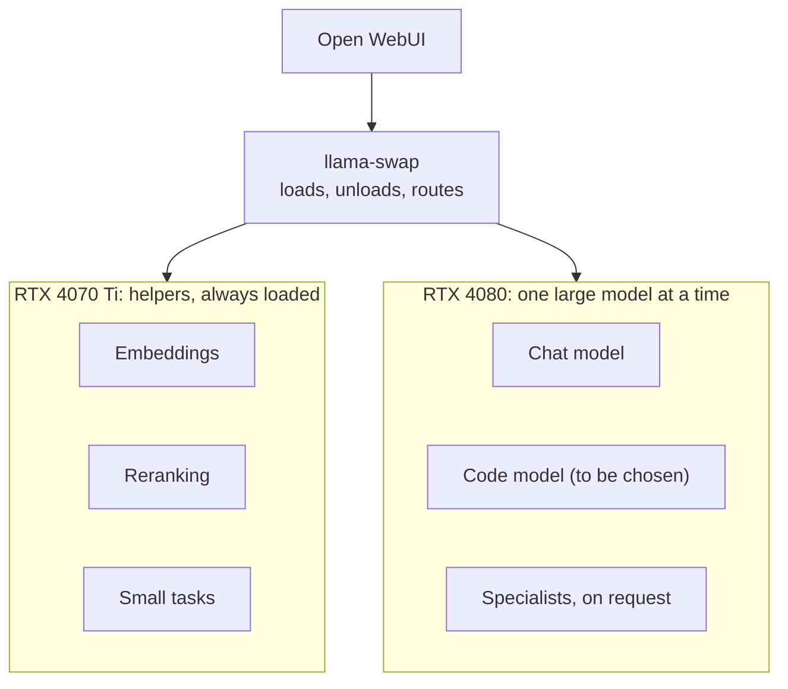

# AI pipeline

## How a question gets answered

**Ingest, once per document.** Docling extracts the text, including formulas. The text is split into chunks, turned into vectors by an embedding model, and stored in PostgreSQL with pgvector.

**Ask, every question.** The system searches by meaning and by keyword and retrieves 12 candidate chunks. A reranking model keeps the best five. The chat model answers from them and shows its sources.

**Extras.** Web search runs through a self-hosted SearXNG instance. A built-in memory tool lets the model recall details across chats.

## Models

| Role | Model |
| --- | --- |
| Chat | gpt-oss-20b |
| Embeddings | embeddinggemma-2 |
| Reranking | Qwen3-Reranker-4B |
| Small tasks | qwen2.5:3b |

## Retrieval settings

- Chunk size 1000, overlap 200
- Retrieve top 12, rerank to top 5
- Hybrid search (meaning plus keyword)

## GPU and model management (planned)

- **4070 Ti:** the small helper models stay loaded, so retrieval never waits on a model load.
- **4080:** one large model at a time, unloaded when idle.
- **llama-swap:** applications ask for a model by name through one endpoint. It loads and unloads models as needed.

## Status

The pipeline ran end to end on an earlier build. I am consolidating all inference into one Docker container on Proxmox.

## Results

- Indexed a full electronics textbook, about 2,150 chunks, and answered questions from it with cited sources.

